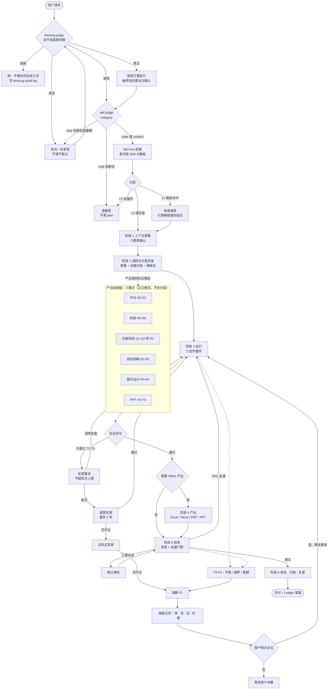

# 流程模型（ai-workflow 流程活动图与决策节点）

> **定位**：把「七段主干 + 多闭环 + 三轴叠加」显式为**流程模型**——一份活动图（mermaid）+ 一张决策节点表（T/R/F/M 触发点映射）。它是 P0 数据模型 / 状态模型之上的"**流转层**"，回答"**什么时机回流到哪个闭环**"。
> **版本**：v2（2026-10-20，对齐 `SKILL.md` v4.41.0）
>
> ⚠️ **建模边界（写在最前）**：本流程本质是「**纪律 + 留痕**」而非纯可执行 DAG——很多节点是"人审 / 纪律"，**不该硬塞进状态机或强制编排**。流程模型只描述「可机判定的流转」；**人审节点标为人工网关**（见 §五），不假装能自动执行。纯文档/可视化，不阻塞质量、不新增门禁。
>
> ⚠️ **不复制正文**：本文件只做流转抽象。每个节点的取值、阈值与契约**只以对应手册为准**（索引见 §七），此处不复述以免形成第二口径源。

---

## 一、阶段主干（阶段 0–6）

| 阶段 | 职责 | 关键产出 | 性质 |
| --- | --- | --- | --- |
| **0 意图判定** | thinking-judge 任务审计 → self-judge 意图快判 → 入口分型 → KB-First 与查 Skill → 定工作区根 | `meta.思考判定`、`meta.入口判定`、分层 L0/L1/L2 | 判别（快） |
| **1 上下文收集** | 三类并行收集 + 材料理解 + 六要素确认 | 任务确认表、用户放行留痕 | 收集/对齐 |
| **2 调研与方案评审** | 查重优先 + 证据分级 + ≥2 候选方案对比 | 复用决策、方案评审结论 | 决策 |
| **3 AI 处理** | 计划 → 验证闭环 → 精检索 → 编排 → 质检 | `plan.yaml` 步骤推进、`trace.jsonl` | 执行 |
| **4 Office 产出** | 生成 Excel / Word / PDF / PPT | 交付文件 | 产出（**条件性**） |
| **5 测试交付** | 验证信号 + Anti-drop 对账 + 熔断门禁 + 出站扫描 + 抽查制审核 | 自检表、`present_files` | 验收 |
| **6 结果核验** | 达成判定 + 履历归档 + 复盘四问 + 沉淀分流 | `Ledger.md` 行、`_metrics.jsonl` | 收尾 |

> **阶段 4 是条件性的**：只有产出形态需要 Office 文件时才走；纯代码、纯文本、纯分析任务由阶段 3 直接进阶段 5。把它当作每任务必经的第七步，是旧图最容易造成的误读。

---

## 二、关键闭环与子机制（决定"何时回流"的才是重点）

| 机制 | 位置 | 触发 | 去向 |
| --- | --- | --- | --- |
| thinking-judge 审计 | 阶段 0 最前 | T1–T4 / 否决轴 A1–A6 | 接受／修正／澄清／**拒绝** |
| self-judge 快判 | 阶段 0 | 单次前向 | chat／code／content → 分层 |
| KB-First 检索 | 阶段 0（流程被调用即生效） | 作答或执行前 | 命中即复用，不重复造 |
| 三轴叠加 | 阶段 1–6 之上（正交） | 六模式识别三判据 | 改**产出结构**，不改分层 |
| 方法选用（method-judge） | 阶段 3 每步动手前 | gap_class / confidence | 换手段，不换目标 |
| 检索快判（retrieval-judge） | 阶段 3 精检索前 | 源类判定 | 选检索源 |
| 自主决策层 | 贯穿全阶段 | 能力路由 / 自适应计划 / 方法选用 | 见 `decision-tables.md` |
| 反思重试 | 阶段 3 内层（验证失败第一响应） | T1–T3 | 调参复跑；耗尽 → 返修复查 |
| 返修复查 | 阶段 3/5（人工/审核驱动） | 反思重试触顶 | 2 轮不过 → 对抗互审 |
| 抽查制审核 | 阶段 5 | 高危产出／用户点名／返修触顶 | 必送独立审核；其余自查＋机器门禁 |
| 熔断 | 末梢兜底 | F1–F5（含 T 触顶 / 环境硬失败） | 停止自动化，等用户复位 |
| 子代理编排 | 阶段 3（算力类能力） | 能力类=算力 | Handoff 结构化派发 |
| 自适应计划 | 阶段 3（执行中） | R1–R6 | 重规划（先留痕再改） |

> **与旧版的差别（v2）**：v1 只有 self-judge 一个入口判据、只有 self-judge→分层 一条链，且把阶段 4 画成必经；v2 补入 thinking-judge（v4.11）、三轴叠加（v4.20 起六模式）、阶段 4 条件性与阶段 5 抽查制。

---

## 三、活动图（mermaid）

> ⚠ **人工网关**（图中未显式画的"纪律节点"）：阶段 1 六要素确认、阶段 2 方案评审、用户放行、返修复查的问题清单、抽查制的送审判断、熔断复位——这些由人/纪律驱动，不在自动 DAG 内。
>
> ⚠ **图不表达"必然"**：`S5 -->|FAIL 未清| S3` 是回流**许可**，不是自动重跑；`RS` 只有用户能置真。

---

## 四、决策节点表（T / R / F / M 触发点映射）

| 节点 | 触发判据 | 决策 | 去向 | 机检 | 人工网关 |
| --- | --- | --- | --- | --- | --- |
| 任务审计 | thinking-judge `verdict` | 接受／修正／澄清／拒绝 | 继续／改条件／回问／停 | 检查项 24（L2 缺省 FAIL） | 拒绝的申诉由人裁 |
| 入口分类 | self-judge `category` ∈ {chat,code,content} | 定分层 L0/L1/L2 | 直答／快速通道／全流程 | 检查项 13（WARN） | 模糊 → 澄清（fail-closed） |
| 模式选用 | 六模式识别三判据 | 叠加哪种产出结构 | 不改分层，只改产出骨架 | 检查项 18/19（作业判定） | 判不准按不叠加处理 |
| 方法选用 | method-judge `gap_class` / `confidence` | 换不换手段 | 同目标换工具 | 检查项 14/15（结构＋抽样） | 抽样人审 |
| 检索源 | retrieval-judge 源类 | 用哪类源 | 本地／技能／联网 | 检查项 16/17 | 抽样人审 |
| 重规划 | R1–R6 任一命中 | 必须重规划 | 先留痕再改 steps | 口径守卫（取值） | 改"目标/事实"才重规划 |
| 反思重试 | T1–T3 命中且未耗尽重试 | 调参再跑 | 同实现复跑 | 重试次数 ≤ 上限（机检） | 反思质量靠抽查 |
| 返修复查 | 反思重试触顶 | 带问题清单回归 | 2 轮 → 对抗互审 | — | ✅ 人工/审核驱动 |
| 抽查送审 | 高危／点名／返修触顶 | 是否送独立审核 | 送审／自查了结 | 审查记录可回溯 | ✅ 判断本身是人审 |
| 熔断 F1 | 返修 2 轮 + 对抗互审仍不过 | 熔断 | 停/冻/证/拦/报 | `_check_fuse`（FAIL） | 须硬证据 |
| 熔断 F3–F5 | 环境类硬失败 / 越界 / 配额硬阻断 | 熔断 | 不耗重试次数 | `_check_fuse` | 须硬证据 |
| 复位 | 用户明示（两步缺一不可） | 已熔断→正常 | 回阶段 3 一次性重试 | `_check_fuse` | ✅ 仅用户 |
| 出站 | 将外发全部文件 | 扫描 + 列清单 | 阻断/放行 | 第 3/4 项机检 | 第 1/2/5/6/7/8 纪律 |

---

## 五、人审网关标注（流程模型不自动执行的部分）

以下节点**只能由人或纪律驱动**，流程模型显式标出，避免"有图却什么也没保证"的假安全感：

1. 阶段 1 六要素确认与用户放行（红线①：用户确认前不执行）。
2. 阶段 2 方案评审的"≥2 候选对比"结论。
3. 阶段 5 抽查制的"该不该送审"判断，以及送审后的裁决。
4. 返修复查的问题清单与对抗互审裁决。
5. 熔断复位（须用户明示，且两步缺一不可——见 `state-model.md` §三）。
6. 出站清单的"可见性 / 留存期 / 回滚"确认。

---

## 六、诚实边界

1. **流程模型是蓝图，不是编排器** —— 它描述"何时回流"，不强制"必须回流"；纪律节点（§五）的履行靠人，不靠图。
2. **与状态模型 / 决策模型正交** —— 状态模型管"状态与迁移"（`state-model.md`），决策模型管"输入→输出映射"（`decision-tables.md`），本文件管"流转时序"，三者互补不重叠。
3. **T/R/F/M 计数正交** —— 重规划次数 ≠ 反思重试次数 ≠ 返修复查轮次 ≠ 熔断次数（见 `reflection-retry.md` §6 计数纪律），报告时显式区分。
4. **图不是门禁** —— 本文件不新增任何检查项；机器判据以 `checks.py` 为准，图与代码不一致时**以代码为准**并回改本文件。
5. **六模式的"三判据"只作索引** —— 各模式的完整识别判据在其手册里；图中并列不表示互斥，一个任务可同时叠加多个。

---

## 七、手册索引（细节只以这些为准）

| 主题 | 唯一口径源 |
| --- | --- |
| 阶段 0–6 正文与红线 | `SKILL.md` |
| 思考裁决取值与阈值 | `thinking-panel.md` |
| 入口快判取值与映射 | `self-judge.md` |
| 十类决策集中表（含方法/检索/模式/学习/文风） | `decision-tables.md` |
| 状态与迁移（熔断） | `state-model.md` |
| 反思重试与计数纪律 | `reflection-retry.md` |
| 证据分级与反模式 | `quality-gates.md` |
| 六模式正文 | `homework-mode.md`／`research-mode.md`／`teardown-mode.md`／`diagram-mode.md`／`ppt-mode.md` |

---

## 变更记录

- **v1（2026-09-21，P2-1）**：新增本文件。把六阶段主干 + 子循环显式为活动图与决策节点表（R/F/T 触发点映射），并标注人工网关与诚实边界。背景：P0 建模分析把"流程模型（4.3）"列为 P2，价值在可读性与未来编排，当前不阻塞质量。
  - ⚠ **纯文档/可视化**：未新增任何门禁或解析器；活动图与 §二/§四均依据 `SKILL.md` 阶段 0–6 与四份决策/状态源手册实测内容，不凭印象。
  - ⚠ **与 P0 模型衔接**：熔断/复位节点以 `state-model.md` 为唯一口径源；R/T 触发以 `decision-tables.md` 为集中映射。
- **v2（2026-10-20，对齐 SKILL.md v4.41.0）**：补齐 v1 滞后于正文的部分。
  - **活动图重画**：新增 thinking-judge 四态（含"拒绝即停、不写审计之外任何产出"与"澄清回问"两条出口）、KB-First、入口分型、三层分流、阶段 4 条件性、阶段 5 抽查送审、F3–F5 直达熔断、复位两步，以及六模式叠加子图。
  - **阶段表**：标题由「六阶段主干」更正为「阶段 0–6」；阶段 0 职责补 thinking-judge；阶段 5 补抽查制。
  - **决策节点表**：新增任务审计、模式选用、方法选用、检索源、抽查送审五行；机检列补已知检查项编号。
  - **新增 §七 手册索引**：明确"细节只以手册为准"，防止本文件被当作第二口径源。
  - **本次未做**：未改 `SKILL.md` 与任何脚本；未新增检查项；未推送远端仓。
  - **遗留**：v1 起即存在的"图不覆盖全部机器检查项"未变——图的完备性没有机器 oracle，只能靠正文变更时人工回改。
